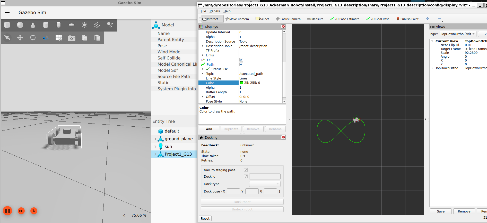

# Project 1 - G13 Ackermann Robot

## Group Members

- David Solis
- William Amaya
- Bolívar Holguín

## Project Description

This project contains the ROS 2 simulation of an Ackermann steering robot. The
robot model was exported from Fusion 360 and adapted to work with ROS 2 Jazzy,
Gazebo Harmonic, ros2_control, and RViz.

The simulation includes:

- An Ackermann robot model with front steering joints and rear traction wheels.
- An Ackermann steering controller using ros2_control.
- A Python node that follows a figure-eight trajectory.
- Planned and executed path publication.
- Robot and trajectory visualization in Gazebo and RViz.

## Requirements

The main supported environment is:

- Ubuntu 24.04 (Noble Numbat).
- ROS 2 Jazzy Jalisco.
- A desktop session with graphical application support.

Windows users can run the same project with Ubuntu 24.04 on WSL 2. See the
[Windows with WSL](#windows-with-wsl) section before continuing with the common
installation steps.

## Linux Installation

Open a terminal and move to the repository root:

~~~bash
cd /path/to/Project1_G13_Ackerman_Robot
~~~

All commands in the following sections must be executed from this directory.

### 1. Install ROS 2 Jazzy

If ROS 2 Jazzy is not installed, run:

~~~bash
sudo bash scripts/install_ros2_jazzy.sh
~~~

After the installation finishes, update rosdep:

~~~bash
rosdep update
~~~

The ROS 2 installation only needs to be performed once.

### 2. Install Project Dependencies

Install the Gazebo, Ackermann controller, and relay packages:

~~~bash
sudo apt update
sudo apt install -y \
  ros-jazzy-ros-gz-sim \
  ros-jazzy-ros-gz-bridge \
  ros-jazzy-gz-ros2-control \
  ros-jazzy-ackermann-steering-controller \
  ros-jazzy-joint-state-broadcaster \
  ros-jazzy-topic-tools
~~~

The remaining dependencies declared in the package manifests are resolved by
the build script.

### 3. Build the Workspace

Run:

~~~bash
./scripts/build.sh
~~~

Load ROS 2 and the workspace overlay:

~~~bash
source scripts/ros2_env.sh
~~~

Run this command again whenever a new terminal is opened:

~~~bash
source scripts/ros2_env.sh
~~~

The environment can be checked with:

~~~bash
./scripts/verify.sh
~~~

## Windows with WSL

Windows 10 and Windows 11 users can run the project through WSL 2. Graphical
support through WSLg is required to display Gazebo and RViz.

### 1. Install or Open Ubuntu 24.04

If Ubuntu 24.04 is not installed, open PowerShell as administrator and run:

~~~powershell
wsl --install --distribution Ubuntu-24.04
~~~

Restart Windows if requested. To open the correct distribution later, run:

~~~powershell
wsl --distribution Ubuntu-24.04
~~~

Do not use an Ubuntu 22.04 distribution for this project because ROS 2 Jazzy
targets Ubuntu 24.04.

Only the `wsl` commands above are executed in PowerShell. All ROS 2,
installation, build, and simulation commands must be executed inside the
Ubuntu 24.04 terminal.

### 2. Locate the Repository

Windows drives are mounted below /mnt. For example, this repository is
available from WSL at:

~~~bash
cd /mnt/d/repositories/Project1_G13_Ackerman_Robot
~~~

Change the drive letter and directories if the repository is stored elsewhere.
For better compilation performance, the repository may also be cloned inside
the Linux home directory.

After entering the repository directory, follow the same
[Linux Installation](#linux-installation) steps and the execution instructions
below. Gazebo and RViz windows are displayed in Windows through WSLg.

## Run the Simulation

The complete project uses four terminals. Keep each command running while
starting the following terminal.

In every new terminal, first move to the repository root and load the
environment:

~~~bash
cd /path/to/Project1_G13_Ackerman_Robot
source scripts/ros2_env.sh
~~~

WSL users should replace /path/to/Project1_G13_Ackerman_Robot with their WSL
path, such as /mnt/d/repositories/Project1_G13_Ackerman_Robot.

### Terminal 1: Start Gazebo

~~~bash
ros2 launch Project1_G13_description gazebo.launch.py
~~~

Wait until the robot appears in Gazebo and both controllers are active. Their
state can be checked from another prepared terminal:

~~~bash
ros2 control list_controllers
~~~

The expected result is:

~~~text
ackermann_steering_controller  active
joint_state_broadcaster        active
~~~

### Terminal 2: Relay the Odometry Transform

The Ackermann controller publishes its odometry transform on
/ackermann_steering_controller/tf_odometry. Relay it to /tf so RViz can use
the transformation between odom and base_link:

~~~bash
ros2 run topic_tools relay \
  /ackermann_steering_controller/tf_odometry \
  /tf
~~~

### Terminal 3: Execute the Figure-Eight Trajectory

~~~bash
ros2 run project1_g13_control trajectory_executor \
  --ros-args -p use_sim_time:=true
~~~

The node publishes commands to the Ackermann controller, follows the
figure-eight waypoints, and publishes the planned and executed paths.

### Terminal 4: Start RViz

~~~bash
ros2 launch Project1_G13_description display.launch.py
~~~

RViz displays the robot using the joint states generated by Gazebo and the
Ackermann controller.

## Expected Result

Gazebo should display the robot following a figure-eight trajectory. RViz
should display the robot model and its motion using the odometry and joint
transforms.

## Stop the Project

Press Ctrl+C in each terminal to stop RViz, the trajectory executor, the relay,
and Gazebo.

## Project Structure

~~~text
Project1_G13_Ackerman_Robot/
├── docs/
│   └── ackermann_trajectory.png
├── scripts/
│   ├── build.sh
│   ├── install_ros2_jazzy.sh
│   ├── ros2_env.sh
│   └── verify.sh
└── src/
    ├── Project1_G13_description/
    │   ├── config/
    │   ├── launch/
    │   ├── meshes/
    │   └── urdf/
    └── project1_g13_control/
        └── project1_g13_control/
            └── trajectory_executor.py
~~~
